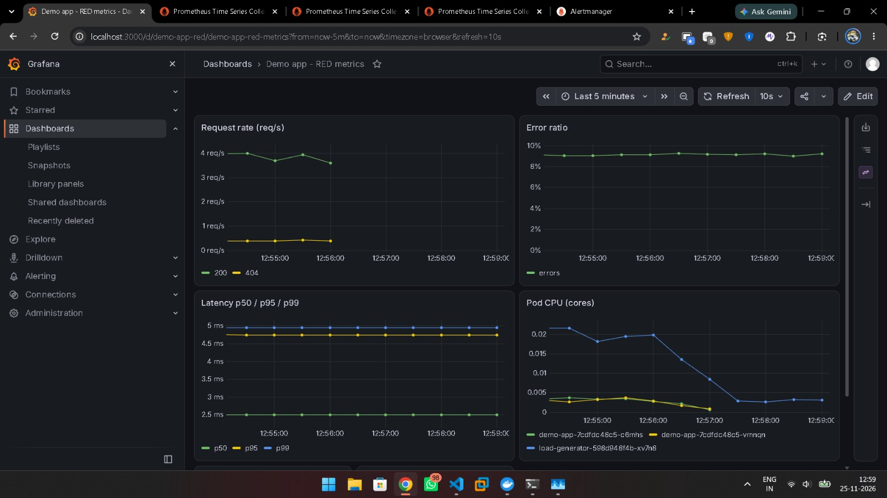
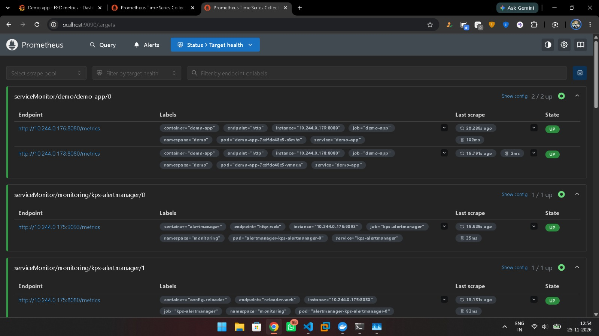
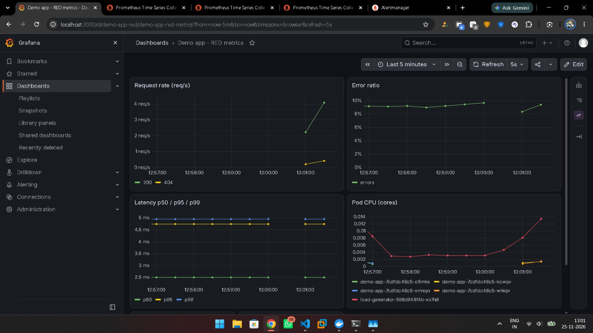
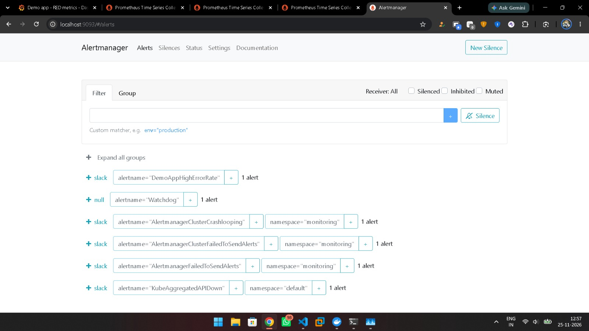

# Kubernetes Observability Platform

Metrics, dashboards and alerting for a Kubernetes cluster using **Prometheus**, **Grafana** and **Alertmanager**, deployed with the `kube-prometheus-stack` Helm chart on a local **kind** or **minikube** cluster. Alerts are tested with `promtool` in CI.



## Architecture

```
app pods (/metrics) ─┐
node-exporter ───────┼──▶ Prometheus ──▶ Alertmanager ──▶ Slack
kube-state-metrics ──┘        │
                              └──▶ Grafana (dashboards)
```

| Component | Purpose |
|---|---|
| Prometheus Operator | Turns `ServiceMonitor` / `PrometheusRule` CRDs into Prometheus config |
| Prometheus | Scrapes, stores and evaluates rules |
| Alertmanager | Groups, deduplicates and routes alerts to Slack |
| Grafana | Dashboards, loaded from ConfigMaps by a sidecar |
| node-exporter / kube-state-metrics | Node and Kubernetes object metrics |
| demo-app + load-generator | Sample workload with RED metrics |

## Repo layout

```
kind-config.yaml            1 control-plane + 2 workers
helm/values.yaml            kube-prometheus-stack config (incl. Alertmanager routing)
demo-app/                   sample app, ServiceMonitor, load generator
alerts/prometheus-rule.yaml alert rules (PrometheusRule CRD)
alertmanager/               Slack secret template
dashboards/                 Grafana dashboard as a ConfigMap
tests/                      promtool unit tests
.github/workflows/          CI: promtool + yamllint + helm template
Makefile                    one-command workflows
```

## Prerequisites

`docker`, `kind` or `minikube`, `kubectl`, `helm`. For linting: `promtool` and `yq` (v4, mikefarah).

## Quick start

```bash
make up                                   # cluster + stack + demo app + rules + dashboard
SLACK_WEBHOOK_URL=https://hooks.slack.com/services/... make slack-secret

make port-forward-grafana                 # http://localhost:3000  (admin / admin)
make port-forward-prometheus              # http://localhost:9090
make port-forward-alertmanager            # http://localhost:9093
```

Open Grafana, then **Dashboards → Demo app - RED metrics**.

### Without `make` (Windows PowerShell + minikube)

```powershell
minikube start --memory=4096 --cpus=2
helm repo add prometheus-community https://prometheus-community.github.io/helm-charts
helm repo update
kubectl create namespace monitoring
kubectl -n monitoring create secret generic alertmanager-slack --from-literal=webhook-url="https://hooks.slack.com/services/REPLACE/ME/PLEASE"
helm upgrade --install kps prometheus-community/kube-prometheus-stack --namespace monitoring -f helm/values.yaml --wait --timeout 20m
kubectl apply -f demo-app/app.yaml
kubectl apply -f demo-app/load-generator.yaml
kubectl apply -f alerts/prometheus-rule.yaml
kubectl apply -f dashboards/
```

Create the Slack secret **before** the chart install, otherwise Alertmanager stays in `Init`.

## Trigger an alert

```bash
make break    # scales demo-app to 0 → DemoAppDown fires after ~1 min
make fix      # restore
```

Watch it move through Pending → Firing in Prometheus (**Alerts**), then see the Slack message. For the error-rate alert, raise the error share: `kubectl -n demo set env deploy/load-generator ERROR_EVERY=3`.

## Screenshots

### Prometheus targets
`demo-app`, Alertmanager and the other ServiceMonitors are all scraped and `UP`.



### Grafana: RED metrics dashboard
Request rate, error ratio, latency percentiles and per-pod CPU for the demo app.


### Outage and recovery
`demo-app` was scaled to zero (the gap in the graphs), then restored; new pods appear in Pod CPU.



### Alertmanager
Alerts are grouped and routed: `DemoAppHighErrorRate` goes to the `slack` receiver and `Watchdog` goes to `null`.



## Alerts

| Alert | Condition | Severity |
|---|---|---|
| DemoAppDown | no healthy demo-app targets for 1m | critical |
| DemoAppHighErrorRate | >5% 4xx/5xx for 5m | warning |
| DemoAppHighLatencyP95 | p95 > 500ms for 10m | warning |
| PodCrashLooping | >3 restarts in 15m | critical |
| PodNotReady | Pending/Unknown/Failed for 10m | warning |
| NodeHighCPU | >85% for 10m | warning |
| NodeHighMemory | >90% for 10m | warning |

Critical alerts inhibit warnings with the same name and namespace.

## Testing rules

```bash
make lint   # promtool check rules
make test   # promtool unit tests
```

The same checks run in GitHub Actions on every push.

## Design notes

- **kind control-plane scraping disabled.** etcd, scheduler, controller-manager and kube-proxy bind to localhost on kind, so scraping them only creates false "target down" alerts. Re-enable them on real clusters.
- **Selector settings.** `*SelectorNilUsesHelmValues: false` lets Prometheus pick up monitors and rules from any namespace, not just those labelled with the Helm release.
- **Secrets.** The Slack webhook lives in a Kubernetes Secret mounted into Alertmanager (`api_url_file`), never in Git.
- **Dashboards as code.** Grafana's sidecar loads any ConfigMap labelled `grafana_dashboard: "1"`.
- The example app returns 404 on `/err`, so the error-rate alert counts 4xx as errors for demo purposes. Use 5xx only for real services.

## Known issues on minikube

- `KubeAggregatedAPIDown` fires for the metrics-server addon. It is harmless.
- With the placeholder Slack URL, `AlertmanagerFailedToSendAlerts` fires. Use a real webhook to clear it.
- Images from quay.io or Docker Hub can time out on slow networks (`ImagePullBackOff`). Pull them with `docker pull` and copy them in with `minikube image load <image>`, then delete the stuck pod.
- cAdvisor exposes pod-level CPU series without a `container` label, so the Pod CPU panel filters on `container=""`.

## Cleanup

```bash
make down          # kind
minikube delete    # minikube
```

## Next steps

- Persistent storage for Prometheus and Grafana
- Ingress for Grafana
- Loki for logs
- Remote-write or Thanos for long-term storage
- Argo CD to manage the stack via GitOps
